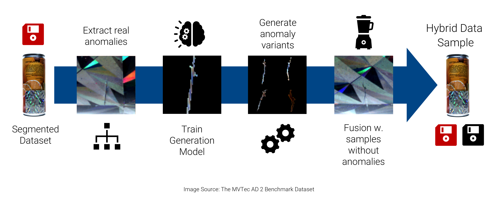

# [Hybrid Sample Generation](https://pfleiderer-adrian.github.io/HybridSampleGeneration/)
 [](https://www.gnu.org/licenses/gpl-3.0) [](https://github.com/Pfleiderer-Adrian/HybridSampleGeneration/actions/workflows/tests.yml) [](https://github.com/Pfleiderer-Adrian/HybridSampleGeneration/actions/workflows/tests.yml) [](https://doi.org/10.1109/AMLDS63918.2025.11159383) [](https://doi.org/10.1109/AMLDS69611.2026.11723773)

This project extracts real anomalies from labelled 2D images or 3D volumes,
trains a generative model, creates multiple synthetic variants and places them
into original control samples. It is based on the IEEE papers
[AMLDS63918.2025.11159383](https://doi.org/10.1109/AMLDS63918.2025.11159383) and
[AMLDS69611.2026.11723773](https://doi.org/10.1109/AMLDS69611.2026.11723773).

**Documentation:** https://pfleiderer-adrian.github.io/HybridSampleGeneration/




## [Installation](https://pfleiderer-adrian.github.io/HybridSampleGeneration/getting-started/installation/)

Python 3.10 or newer is required. Install PyTorch for your CPU/CUDA environment
first if you need a specific build, then:

```bash
python -m pip install hybrid-sample-generator
```

For development or the bundled examples, install from a checkout with
`python -m pip install -e ".[examples]"`. The
[installation guide](https://pfleiderer-adrian.github.io/HybridSampleGeneration/getting-started/installation/) covers optional
dependencies such as image harmonization.

## [Usage](https://pfleiderer-adrian.github.io/HybridSampleGeneration/getting-started/quick-start/)

```python
from hybrid_sample_generator.configuration import Configuration
from hybrid_sample_generator.pipeline.hybrid_data_generator import HybridDataGenerator

config = Configuration("study-01", study_folder="results/study-01")
config.extraction.anomaly_size = (1, 32, 32)   # (C, H, W) of the anomaly cutouts
config.model.set_model("cVAE_ConvNeXt_2D")

generator = HybridDataGenerator(config)
generator.ingest_dataset(dataloader)       # yields (image, segmentation, source_name)
generator.extract_anomalies()
generator.train_generator()
generator.generate_synthetic_anomalies()
generator.plan_hybrid_samples()
generator.materialize_hybrid_samples()

hybrids = generator.datasets.hybrid_samples(numpy_mode=True)
```

`dataloader` is any iterable over channel-first arrays; anomalous samples have
a positive segmentation mask, controls an empty one. The
[quick start](https://pfleiderer-adrian.github.io/HybridSampleGeneration/getting-started/quick-start/) contains a complete script that
runs without data files.

## [Documentation](https://pfleiderer-adrian.github.io/HybridSampleGeneration/)

| Topic | Pages |
| --- | --- |
| Getting started | [Installation](https://pfleiderer-adrian.github.io/HybridSampleGeneration/getting-started/installation/) · [Quick start](https://pfleiderer-adrian.github.io/HybridSampleGeneration/getting-started/quick-start/) |
| Pipeline | [Overview](https://pfleiderer-adrian.github.io/HybridSampleGeneration/guides/pipeline/) · [Input data](https://pfleiderer-adrian.github.io/HybridSampleGeneration/guides/input-data/) · [Extraction](https://pfleiderer-adrian.github.io/HybridSampleGeneration/guides/extraction/) · [Training](https://pfleiderer-adrian.github.io/HybridSampleGeneration/guides/training/) · [Synthetic variants](https://pfleiderer-adrian.github.io/HybridSampleGeneration/guides/generation/) · [Hybrid planning](https://pfleiderer-adrian.github.io/HybridSampleGeneration/guides/matching/) · [Fusion](https://pfleiderer-adrian.github.io/HybridSampleGeneration/guides/fusion/) |
| Results | [Postprocessing](https://pfleiderer-adrian.github.io/HybridSampleGeneration/guides/postprocessing/) · [Evaluation](https://pfleiderer-adrian.github.io/HybridSampleGeneration/guides/evaluation/) · [Visualization](https://pfleiderer-adrian.github.io/HybridSampleGeneration/guides/visualization/) · [Continuing a study](https://pfleiderer-adrian.github.io/HybridSampleGeneration/guides/continuing-studies/) |
| Concepts | [Data model and storage](https://pfleiderer-adrian.github.io/HybridSampleGeneration/concepts/study-storage/) · [Datasets](https://pfleiderer-adrian.github.io/HybridSampleGeneration/concepts/datasets/) · [Glossary](https://pfleiderer-adrian.github.io/HybridSampleGeneration/concepts/glossary/) |
| Reference | [Configuration](https://pfleiderer-adrian.github.io/HybridSampleGeneration/configuration/) · [Generator models](https://pfleiderer-adrian.github.io/HybridSampleGeneration/configuration/models/) |
| Benchmark | [MVTec AD 2](https://pfleiderer-adrian.github.io/HybridSampleGeneration/mvtec-ad2/) |
| Development | [Contributing](https://pfleiderer-adrian.github.io/HybridSampleGeneration/development/contributing/) · [Tests](https://pfleiderer-adrian.github.io/HybridSampleGeneration/development/testing/) · [Releases](https://pfleiderer-adrian.github.io/HybridSampleGeneration/development/releases/) |

## [LLM usage statement](https://pfleiderer-adrian.github.io/HybridSampleGeneration/llm-usage/)

LLM-assisted coding, writing, and analysis are becoming standard in both industry
and research. While these tools entail risks, we believe that, combined with
careful verification of all generated content, they can accelerate scientific
progress. This, however, requires uncompromising transparency about which tools
contributed to the results and to what extent:

- **Implementation and documentation:** Claude (Anthropic) and Codex (OpenAI)
  were used as assistants for implementing, refactoring, and debugging parts of
  the framework, and for writing and editing this README and the code comments.
  All code and documentation were reviewed and validated by the maintainers.
- **Design and experiments:** The architecture, the method, and all experimental
  decisions originate from the maintainers.
- **Models inside the pipeline:** Pretrained models that the framework calls at
  runtime (e.g., the LBM harmonization model) are components of the method, not
  development assistance.

If you find an error, please open an
[issue](https://github.com/Pfleiderer-Adrian/HybridSampleGeneration/issues). Thank you!!

## [Cite this work](https://pfleiderer-adrian.github.io/HybridSampleGeneration/about/#cite-this-work)

```bibtex
@INPROCEEDINGS{11723773,
  author={Pfleiderer, Adrian and Bauer, Bernhard},
  booktitle={2026 2nd International Conference on Advanced Machine Learning and Data Science (AMLDS)},
  title={Hybrid Data Generator as a Generalizable Approach for Optimized Training Data Sets},
  year={2026},
  pages={72-79},
  doi={10.1109/AMLDS69611.2026.11723773}
}
```

## [License](https://pfleiderer-adrian.github.io/HybridSampleGeneration/about/#license)

This project is licensed under the GNU General Public License v3.0. See
`LICENSE` for the complete terms.
