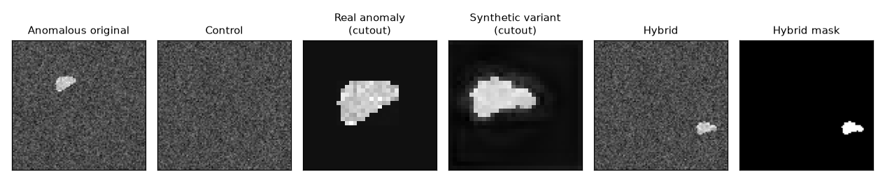
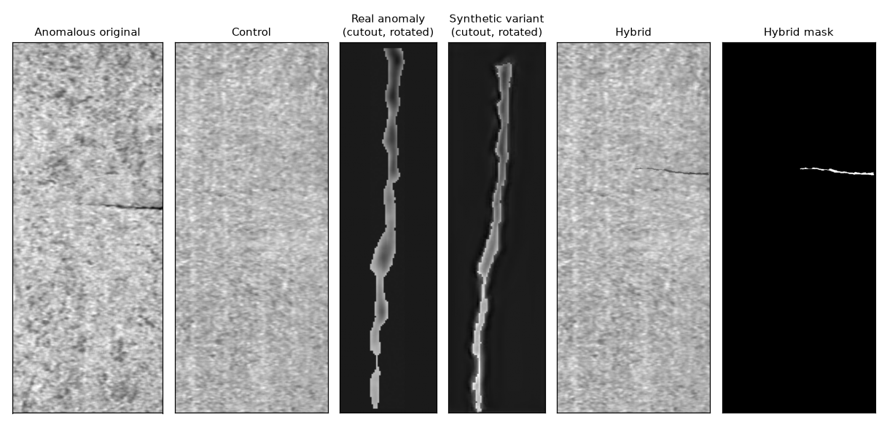

# Quick start

This page contains two complete examples. Both run the whole pipeline and end
with a study folder that can be opened in the
[study browser](../guides/visualization.md).

| Example | Data | Download | Runtime on a GPU |
| --- | --- | --- | --- |
| [Generated toy data](#example-1-generated-toy-data) | noise images with bright blobs, created by the script | none | about 1.5 minutes |
| [KolektorSDD](#example-2-kolektorsdd) | 399 real surface images with cracks | 102 MB | about 4 minutes |

On a CPU both examples take considerably longer.

## Example 1: generated toy data

The script creates gray noise images, half of them with a bright defect. Each
defect is an ellipse of random size and orientation whose outline is
elastically deformed, so no two defects have the same shape. No data files are
needed.

```python
import numpy as np
from scipy.ndimage import gaussian_filter, map_coordinates

from hybrid_sample_generator.configuration import Configuration
from hybrid_sample_generator.evaluation.service import evaluate_study
from hybrid_sample_generator.pipeline.hybrid_data_generator import HybridDataGenerator


def defect_mask(rng, size):
    """Return a randomly placed ellipse with an elastically deformed outline."""
    yy, xx = np.mgrid[:size, :size].astype(np.float32)
    cy, cx = rng.uniform(28, size - 28, size=2)
    ry, rx = rng.uniform(6, 12, size=2)
    angle = rng.uniform(0, np.pi)
    u = (xx - cx) * np.cos(angle) + (yy - cy) * np.sin(angle)
    v = (yy - cy) * np.cos(angle) - (xx - cx) * np.sin(angle)
    ellipse = ((u / rx) ** 2 + (v / ry) ** 2 <= 1).astype(np.float32)
    # Elastic deformation: resample the ellipse along a smooth random field.
    dy, dx = (60 * gaussian_filter(rng.standard_normal((size, size)), 6) for _ in range(2))
    return map_coordinates(ellipse, [yy + dy, xx + dx], order=1) > 0.5


def toy_samples(count=40, size=96, seed=0):
    """Yield (image, segmentation, source_name); every second sample has a defect."""
    rng = np.random.default_rng(seed)
    for index in range(count):
        image = 0.5 + 0.05 * rng.standard_normal((1, size, size))
        mask = np.zeros((1, size, size), dtype=np.uint8)
        if index % 2 == 0:
            defect = defect_mask(rng, size)
            image[0][defect] += 0.3
            mask[0][defect] = 1
        yield image.astype(np.float32), mask, f"sample-{index:03d}"


config = Configuration("quick-start", study_folder="results/quick-start")
config.extraction.anomaly_size = (1, 32, 32)
config.model.set_model("cVAE_ConvNeXt_2D")
config.training.num_trials = 3
config.training.epochs = 200
config.generation.variants_per_real_anomaly = 1
config.matching.hybrids_per_original = 2

generator = HybridDataGenerator(config)
summary = generator.ingest_dataset(toy_samples())
generator.extract_anomalies()
generator.train_generator()
generator.generate_synthetic_anomalies()
generator.plan_hybrid_samples()
generator.materialize_hybrid_samples()
config.save_config_file()

hybrids = generator.datasets.hybrid_samples(numpy_mode=True)
print(len(hybrids), hybrids[0]["img"].shape, hybrids[0]["segmentation"].shape)

evaluate_study(config)
```

The script prints the progress of every stage and ends with the number and
shape of the hybrids, `40 (1, 96, 96) (1, 96, 96)`, followed by the evaluation
summary. The study folder `results/quick-start/` then contains the
configuration, the database, the trained model and all arrays; see
[data model and storage](../concepts/study-storage.md).



*One hybrid of the toy study with the samples it was built from.*

### What happened

1. `ingest_dataset()` stored all 40 originals: 20 anomalous ones and 20
   controls with an empty mask.
2. `extract_anomalies()` cut out the 20 defects as real anomalies.
3. `train_generator()` trained a mask-conditioned VAE on them in three Optuna
   trials of 200 epochs each and loaded the best trial.
4. `generate_synthetic_anomalies()` created one variant per real anomaly.
5. `plan_hybrid_samples()` chose, for each of the two hybrids per control, a
   synthetic anomaly and a position by template matching.
6. `materialize_hybrid_samples()` fused the anomalies into the controls and
   wrote the hybrid images and masks.
7. `evaluate_study()` compared every synthetic anomaly with its real parent.

Each stage is described in the [pipeline overview](../guides/pipeline.md).

??? note "Changed defaults"

    | Parameter | Default | Here | Reason |
    | --- | --- | --- | --- |
    | `extraction.anomaly_size` | `(3, 64, 64)` | `(1, 32, 32)` | one channel, small defects |
    | `training.num_trials` | `10` | `3` | short runtime |
    | `training.epochs` | `1000` | `200` | short runtime |
    | `generation.variants_per_real_anomaly` | `3` | `1` | one variant per defect is enough here |
    | `matching.hybrids_per_original` | `1` | `2` | two hybrids per control |

## Example 2: KolektorSDD

The [Kolektor Surface-Defect Dataset](https://www.vicos.si/resources/kolektorsdd/)
contains 399 grayscale images of electrical commutator surfaces, 52 of them
with a crack and a pixel mask. Its cracks are thin, start at the right image
border and differ strongly in shape, which makes it a compact real test for
every pipeline stage.

!!! note "License"
    KolektorSDD is licensed under CC BY-NC-SA 4.0 and may only be used for
    non-commercial purposes. It is not part of this repository; download it
    from the dataset page. If you use it, cite Tabernik et al., *Segmentation-based
    deep-learning approach for surface-defect detection*, Journal of
    Intelligent Manufacturing, 2020.

Download and unpack the dataset, and install Pillow for reading the images:

```bash
curl -L -o KolektorSDD.zip https://go.vicos.si/kolektorsdd
python -m zipfile -e KolektorSDD.zip KolektorSDD
python -m pip install pillow
```

The folder `KolektorSDD/` then contains `kos01` to `kos50`, each with images
`PartN.jpg` and masks `PartN_label.bmp`. Run the script from the folder that
contains `KolektorSDD/`:

```python
from pathlib import Path

import numpy as np
from PIL import Image

from hybrid_sample_generator.configuration import Configuration
from hybrid_sample_generator.evaluation.service import evaluate_study
from hybrid_sample_generator.pipeline.hybrid_data_generator import HybridDataGenerator

DATA_ROOT = "KolektorSDD"  # folder that contains kos01 ... kos50


def kolektor_samples(root):
    """Yield (image, segmentation, source_name) for every KolektorSDD surface image."""
    for image_path in sorted(Path(root).glob("kos*/Part*.jpg")):
        mask_path = image_path.with_name(image_path.stem + "_label.bmp")
        image = np.asarray(Image.open(image_path).convert("L"), dtype=np.float32)
        mask = (np.asarray(Image.open(mask_path).convert("L")) > 0).astype(np.uint8)
        yield image[None], mask[None], f"{image_path.parent.name}/{image_path.stem}"


config = Configuration("kolektor", study_folder="results/kolektor")

# Extraction: wide grayscale cutouts
config.extraction.anomaly_size = (1, 64, 256)

# Training
config.model.set_model("cVAE_ConvNeXt_2D")
config.training.num_trials = 3
config.training.epochs = 200
config.training.batch_size = 16

# Generation: stronger latent variation and more mask transforms
config.generation.variation_strength = 1.0
masks = config.augmentation.mask_transforms
masks.setGlobalParam("zoom", min_zoom=0.9, max_zoom=1.0)
masks.setGlobalParam("stretch", min_stretch=1.0, max_stretch=1.15)
masks.setGlobalParam("rotate", probability=1.0, max_rotation=4.0)
masks.setAllClassParams("local_dilate", probability=0.5, max_iterations=2)

# Planning: lazy matching with equally weighted scores
config.matching.routine = "local"
config.matching.intensity_weight = 1.0
config.matching.gradient_weight = 1.0
config.matching.distance_weight = 1.0

generator = HybridDataGenerator(config)
generator.ingest_dataset(kolektor_samples(DATA_ROOT))
generator.extract_anomalies()
generator.train_generator()
generator.generate_synthetic_anomalies()
generator.plan_hybrid_samples()
generator.materialize_hybrid_samples()
config.save_config_file()

hybrids = generator.datasets.hybrid_samples(numpy_mode=True)
print(len(hybrids), hybrids[0]["img"].shape, hybrids[0]["segmentation"].shape)

evaluate_study(config)
```

The script ends with `347 (1, 1266, 500) (1, 1266, 500)`: one hybrid for each
of the 347 defect-free images. During extraction, four mask fragments of fewer
than 163 pixels are reported as `Anomaly region ... omitted`; this is the
`min_coverage_ratio` filter and leaves 54 real anomalies.



*One hybrid of the KolektorSDD study: the synthetic crack is a variant of the
real crack on the left and was fused into a defect-free surface. Images are
derived from KolektorSDD (CC BY-NC-SA 4.0).*

??? note "Changed defaults"

    The cracks are much wider than tall and differ strongly in shape, and the
    dataset is small. Extraction, training, generation and planning are adapted
    to that; fusion uses its defaults.

    | Parameter | Default | Here | Reason |
    | --- | --- | --- | --- |
    | `extraction.anomaly_size` | `(3, 64, 64)` | `(1, 64, 256)` | grayscale images; cracks are about 50 × 250 pixels |
    | `training.num_trials` | `10` | `3` | short runtime |
    | `training.epochs` | `1000` | `200` | short runtime |
    | `training.batch_size` | `64` | `16` | only 54 real anomalies |
    | `generation.variation_strength` | `0.5` | `1.0` | more texture variation |
    | mask transform `zoom` | fixed `0.9` | `0.9`–`1.0` | variants keep up to their full length |
    | mask transform `stretch` | `1.0`–`1.2` | `1.0`–`1.15` | slightly less growth |
    | mask transform `rotate` | off | up to 4° | cracks with different slopes |
    | mask transform `local_dilate` | off | probability `0.5`, up to 2 iterations | cracks of different thickness |
    | `matching.routine` | `batchwise` | `local` | one template match per control instead of up to 32; the images are large |
    | `matching.gradient_weight` | `2.0` | `1.0` | intensity, gradient and distance count equally |
    | `matching.distance_weight` | `0.0` | `1.0` | keeps cracks near the position of their real parent |

The guides explain these settings in detail:
[extraction](../guides/extraction.md),
[synthetic variants](../guides/generation.md#target-masks) and
[hybrid planning](../guides/matching.md).

## Inspect the study

Open the [study browser](../guides/visualization.md) for a finished study:

```bash
python -m hybrid_sample_generator.visualization results/quick-start
```

## Use your own data

Replace the sample generator with any iterable that yields
`(image, segmentation, source_name)` with channel-first arrays, and set
`config.extraction.anomaly_size` to the channel count and cutout size of your
data. [Input data](../guides/input-data.md) describes the requirements.

The repository contains loaders for image folders and NIfTI volumes. Install
their dependencies with `python -m pip install -e ".[examples]"`, set the data
paths in the example's `main.py` and run it from the repository root:

```bash
python -m examples.image_2d.main
python -m examples.nifti_3d.main
```

The [MVTec AD 2 benchmark](../mvtec-ad2/index.md) is a complete application
with grouped data splits, several synthetic anomaly sources and a downstream
segmentation model:

```bash
python -m examples.mvtec_ad2.run --category can
```

## Next steps

- [Continue or repeat](../guides/continuing-studies.md) single stages of a
  study.
- Tune [training](../guides/training.md),
  [hybrid planning](../guides/matching.md) and [fusion](../guides/fusion.md).
- Look up parameters in the [configuration reference](../configuration/index.md).
