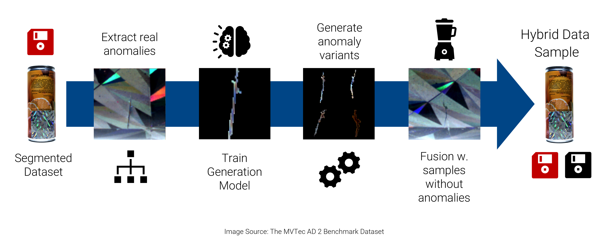

# Hybrid Sample Generation
   

This project extracts real anomalies from labelled 2D images or 3D volumes,
trains a generative model, creates multiple synthetic variants and places them
into original control samples. It is based on the IEEE papers
[AMLDS63918.2025.11159383](https://doi.org/10.1109/AMLDS63918.2025.11159383) and
[AMLDS69611.2026.11723773](https://doi.org/10.1109/AMLDS69611.2026.11723773).

## Start here

- [Install the package](getting-started/installation.md) and run the
  [quick start](getting-started/quick-start.md), which needs no data files.
- Follow the [pipeline overview](guides/pipeline.md) from
  [input data](guides/input-data.md) through
  [extraction](guides/extraction.md), [training](guides/training.md),
  [generation](guides/generation.md), [planning](guides/matching.md) and
  [fusion](guides/fusion.md).
- Check the results with [postprocessing](guides/postprocessing.md),
  [evaluation](guides/evaluation.md) and the
  [study browser](guides/visualization.md), or
  [continue a study](guides/continuing-studies.md) later.
- Look up parameters in the [configuration reference](configuration/index.md)
  or with the search box, and terms in the [glossary](concepts/glossary.md).
- Reproduce the [MVTec AD 2 benchmark](mvtec-ad2/index.md) with its downstream
  models.
- See [citation and license](about.md) and how to
  [contribute](development/contributing.md).
